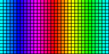

# retropixel

RGB matrix on a microcontroller, driven by the PC over USB-CDC with a
lean binary protocol (start token, length, data, CRC-16).

The controller is not just a dumb receiver: after reset it announces itself
once per second with a `READY` token that carries its display geometry.
So the PC doesn't need to know anything about the hardware — it asks.

```
┌──────────────┐      USB-CDC        ┌─────────────────┐   WS2812B
│  PC (Python) │ ◄─────────────────► │  Nano / Pico    │ ──────────► Panel(s)
│  script/     │   MX8 protocol      │  FW/ (FastLED)  │   1…4 data pins
└──────────────┘                     └─────────────────┘
```

Two setups are configured; switching between them takes **one line** in
`FW/mx8_config.h`:

| `MX_BOARD` | Area | Panels | Data pins |
|---|---|---|---|
| `MX_BOARD_8X8` | 8×8 = 64 LEDs | one 8×8 board | D6 |
| `MX_BOARD_16X32` | 32×16 = 512 LEDs | two 8×32 stacked | GP14 and GP17 |

> How a store-bought "8×32" panel is wired internally isn't in any
> datasheet. These ones run **column-wise in a serpentine (zigzag)**: eight pixels
> down the column, the next one back up. `script/mapcheck.py` measures that
> in thirty seconds — a lot faster than guessing.

The host notices none of the difference: it gets the dimensions via `READY` and
sends one contiguous area. How that breaks down into tiles and strands
only the firmware knows.

---

## Behavior after power-on

| State           | Display                      | Serial output        | Left via                                            |
|-----------------|------------------------------|----------------------|-----------------------------------------------------|
| **BOOT** (5 s)  | black                        | `READY` every second | valid `FRAME` → RUNNING · 5 s → TEST                |
| **TESTPATTERN** | 4 demos, switching every 6 s | `READY` every second | valid `FRAME` → RUNNING                             |
| **RUNNING**     | whatever the PC sends        | only `ACK`/`NACK`    | `RELEASE` → TEST · **1 min without a frame → DARK** |
| **DARK**        | black                        | `READY` every second | valid `FRAME` → RUNNING                             |

In practice: plug in the panel → 5 s of black with "I'm ready" calls →
then the demo runs, and the ready calls keep going. As soon as a Python script
sends the first frame, the PC takes over.

**If the PC drops out after that, the display goes black after 1 minute** — and
stays that way. Deliberately not back to the demo: as long as no PC has ever
shown up, the demo is the sensible sign of life; once a PC has been in control,
its silence is a fault, and a demo springing back to life would look
like normal operation. A valid `FRAME` brings the display back immediately.

The minute lives as `MX_PC_TIMEOUT_MS` in `FW/mx8_config.h`. `RELEASE` is
exempt from it — the orderly "I'm done" still leads back to the demo.

`PING` and `HELLO` deliberately trigger **no** mode change: the PC may
knock without killing the demo.

---

## Layout

```
retropixel/
├── FW/                          Arduino sketch
│   ├── FW.ino                   main program, state machine, test pattern
│   ├── mx8_config.h             ← adjust HERE: chipset, pins, geometry
│   ├── mx8_protocol.h           framing constants + CRC-16
│   ├── mx8_rx.h                 RX state machine (hardware-free, testable)
│   └── mx8_map.h                tile mapping (x,y) → chain index, testable
├── script/                      Python host
│   ├── hello_rainbow.py         scrolling text in rainbow colors
│   ├── smiley.py                smiley animation with smooth transitions
│   ├── speedtest.py             latency, throughput and flood measurement
│   ├── mapcheck.py              measure panel wiring → config block
│   ├── pixelwalk.py             every pixel individually, one per second
│   ├── rainbow.py               rainbow across the whole area, 6 patterns
│   ├── mx8_cli.py               command line (ports/monitor/demo/image/preview)
│   ├── mx8/protocol.py          framing/CRC — mirror of mx8_protocol.h
│   ├── mx8/mapping.py           pixel mapping — mirror of mx8_map.h
│   ├── mx8/link.py              serial connection, READY handshake, ACK flow
│   ├── mx8/framebuffer.py       RGB buffer + ANSI terminal preview
│   ├── mx8/font5x7.py           5×7 font as ASCII art, ASCII + umlauts
│   └── mx8/patterns.py          host animations
├── tests/                       cross-test C ↔ Python, no hardware needed
├── tools/build_check.sh         build firmware against real FastLED
├── docs/wiring.html             wiring diagram as a graphic (open in browser)
├── docs/pixelgrid.html          pixel grid for square pixels (16×16 build)
├── docs/rainbow.gif             the six rainbow patterns
├── PROTOCOL.md                  complete protocol specification
├── WIRING.md                    wiring, power budget, pitfalls
└── README.md
```

---

## Hardware

| | |
|---|---|
| Board | Arduino Nano / Nano Every (AVR), **Raspberry Pi Pico** (RP2040) or **Pico 2 / 2 W** (RP2350) |
| Panel | WS2812B / NeoPixel-compatible, one or more modules |
| Data | one pin per panel → DIN, ideally with 330 Ω in series |
| Ground | GND controller **and** GND power supply **and** GND panel tied together |
| 5 V | see warning below |

From about 256 LEDs on, the **Pico** is clearly the better choice: native USB-CDC
has no baud rate limit, and FastLED clocks the LEDs out there via PIO+DMA in the
background instead of disabling interrupts. See
[PROTOCOL.md §6](PROTOCOL.md).

**→ Complete wiring diagram with power budget: [WIRING.md](WIRING.md)**
(graphical: open [`docs/wiring.html`](docs/wiring.html) in a browser)

> **Power supply.** 64 WS2812B draw about **3.8 A** at full white. The
> Nano Every's 5V pin can't handle that — it hangs off USB and tops out at
> ~500 mA. Two clean options:
>
> 1. **External 5V power supply** to the panel, GND tied to the Nano. A
>    1000 µF electrolytic cap across the panel supply dampens the inrush current.
> 2. **Cap the brightness** (factory default): `MX_BRIGHTNESS_DEFAULT 40`
>    and `MX_MAX_MILLIAMPS 450` make FastLED automatically throttle down
>    far enough that USB power suffices.
>
> The default is deliberately option 2 — it should work right out of
> the box without you frying your USB port.

---

## Flashing the firmware

Required in the Arduino IDE:

* Board package **"Arduino megaAVR Boards"** (Tools → Board → Boards Manager)
* Library **FastLED ≥ 3.6** — older versions don't compile for the
  ATmega4809. Tested against 3.9.x.

Then open `FW/FW.ino` — in the IDE with `Ctrl+O` and the full path, or from
the shell:

```powershell
start FW\FW.ino          # Windows
```

The IDE loads the three headers automatically as additional tabs. Under *Tools*:
board **Arduino Nano Every**, Registers emulation **None (ATMEGA4809)** — then
upload.

> The sketch is deliberately called `FW.ino` and not `matrix8x8_nano_every.ino`: the
> Arduino IDE requires the folder name to match the name of the `.ino`.
> That way the sketch opens straight from the repo, without copying it into the
> sketchbook or creating a junction — and that holds on every machine
> that clones the repo.

### Different panel / different LED type

Everything you need is in `FW/mx8_config.h` — one line selects the setup:

```c
#define MX_BOARD  MX_BOARD_16X32   // or MX_BOARD_8X8
```

The chipset applies to both:

```c
#define LED_CHIPSET      WS2812B   // SK6812, WS2811, APA102, WS2801, LPD8806 …
#define LED_COLOR_ORDER  GRB       // RGB, BGR, … depending on the panel
// #define LED_CLOCK_PIN 7         // only for clocked chips (APA102 & co.)
```

The area is described as **tiles**. A single panel is the
special case 1×1:

```c
#define MX_TILE_W                32   // size of ONE tile (= one panel)
#define MX_TILE_H                8
#define MX_TILES_X               1    // tiles side by side
#define MX_TILES_Y               2    //       stacked vertically

#define MX_TILE_VERTICAL         1    // 0 = chain row-wise, 1 = column-wise
#define MX_TILE_SERPENTINE       1    // 1 = every other row/column reversed
#define MX_TILE_ORIGIN           0    // 0=top-left 1=t-r 2=b-l 3=b-r
#define MX_TILE_FLIP_ALT_ROWS    0    // 1 = every other tile row rotated 180°
#define MX_TILE_ORDER_SERPENTINE 0    // tiles chained in a serpentine

#define MX_STRANDS               2    // data pins
#define LED_DATA_PIN             14   // tile 0  (Pico GP14)
#define LED_DATA_PIN_2           17   // tile 1  (Pico GP17)
```

The host has to change **nothing**: the geometry comes along in the `READY` token,
and the wire format is always plain RGB, row-major, top-left first.
Reordering and tile mapping are the firmware's job.

### Don't guess the wiring — measure it

How a store-bought panel is soldered internally is rarely in the datasheet. Instead
of trying all eight combinations:

```bash
python script/mapcheck.py -p COM4 --tile 32x8 --tiles 1x2 --strands 2
```

The script uses `CMD_RAW` and so writes **without** mapping straight into the
LED chain — whatever lights up is the physical wiring. Four questions later
the finished config block is on screen, and a test image (red dot
top left, green border, tile numbers) shows beforehand whether it's right.
The PC does the mapping math here, so **nothing needs flashing** to
test a hypothesis.

```bash
python script/mapcheck.py --chase        # just run along the chain
python script/mapcheck.py --verify 16x32 # test image with a known preset
```

**Typical failure patterns:**

| Symptom | Cause |
|---|---|
| Red and green swapped | `LED_COLOR_ORDER` — swap `GRB` ↔ `RGB` |
| Dot moves in a **snake line**, every other row mirrored | toggle `MX_TILE_SERPENTINE` (0 ↔ 1) |
| Dot moves **vertically** instead of horizontally | The chain is column-wise: `MX_TILE_VERTICAL 1` |
| Dot only travels **8 pixels**, then jumps | Run length = tile height with a vertical chain. Usually `MX_TILE_VERTICAL 1` + `MX_TILE_SERPENTINE 1` |
| Image rotated by 90° | toggle `MX_TILE_VERTICAL` |
| Image upside down / mirrored | try the `MX_TILE_ORIGIN` values |
| Top half correct, bottom half rotated | `MX_TILE_FLIP_ALT_ROWS` to `1` |
| Bottom half stays dark | second data pin, `MX_STRANDS`, its own 5 V |
| First LED flickers, rest OK | signal level problem: 330 Ω in the data line, shorter cable |

### Two panels as one display area

Each panel gets its **own data pin**. FastLED then clocks them out
simultaneously — `show()` for 512 LEDs takes 7.98 ms instead of 15.66 ms:

```c
FastLED.addLeds<WS2812B, 14, GRB>(leds,   0, 256);   // top panel    (tile 0)
FastLED.addLeds<WS2812B, 17, GRB>(leds, 256, 256);   // bottom panel (tile 1)
```

`FW.ino` does this automatically based on `MX_STRANDS`; up to four strands
are wired up (`LED_DATA_PIN_3`, `LED_DATA_PIN_4`). The strand boundary must fall on
a tile boundary — `mx8_config.h` checks that at compile time.

> **512 WS2812B draw 30.7 A at full white.** That's no longer a USB issue,
> it's a power supply issue. `MX_MAX_MILLIAMPS` is set to 2000 mA for this
> setup; FastLED automatically throttles the brightness far enough that the
> limit is respected. Feed power into both panels at the same point, don't
> daisy-chain it.

### Raspberry Pi Pico

Same firmware, no changes needed — `FASTLED_ALLOW_INTERRUPTS` is now only
set on AVR, because the RP2040 has to keep interrupts enabled (otherwise USB-CDC
dies). In the Arduino IDE:

* Board package **"Raspberry Pi Pico/RP2040"** by *earlephilhower*
* Board *Raspberry Pi Pico*, USB Stack *Pico SDK*
* `MX_SERIAL_BAUD` has no effect on the Pico: native USB-CDC always runs at
  full speed, no matter what baud rate host and firmware report.

On the RP2040, FastLED uses the PIO driver with DMA out of the box
(`FASTLED_RP2040_CLOCKLESS_PIO` defaults to `1`, up to 8 strands
in parallel). So clocking out runs in the background while the next
frame is already coming in.

---

## Python side

```bash
cd script
pip install pyserial          # required
pip install pillow            # optional, only for image/GIF mode
```

### Setting port and baud rate

For **every** script the port comes via `-p`, the baud rate via `-b`:

```powershell
python hello_rainbow.py -p COM4
python speedtest.py -p COM4
python mx8_cli.py demo -p COM4 --pattern plasma
```

If you don't want to type that every time, set it once per console session:

```powershell
$env:MX8_PORT = "COM4"          # PowerShell
```
```bash
export MX8_PORT=/dev/ttyUSB0    # Linux/macOS
```

Precedence: `-p` beats `MX8_PORT`, which beats auto-detection. Likewise
`-b` / `MX8_BAUD` / 115200. `python mx8_cli.py ports` lists what's there.

> **The baud rate has to be the same on both sides** — but the host will find it
> on its own if need be. If no `READY` arrives at the configured value, it tries
> `1000000 → 500000 → 250000 → 115200` in turn and reports the switch in the log.
> An explicit `-b` or `MX8_BAUD` turns the search off.
>
> On the firmware side the rate per setup is in `FW/mx8_config.h`: the 8×8 at
> 115200, the 16×32 setup at **1000000**.

#### On the Pico a higher baud rate buys you nothing

That's not penny-pinching in the wrong place, it's physics: the Pico has
**native USB-CDC**. The "baud rate" there is just a number that host and device
report to each other and both ignore — the transfer runs at USB Full Speed
(12 Mbit/s). 1543 B per frame are gone in just over 1 ms.

The bottleneck is the **WS2812B protocol**: 800 kHz, 24 bits per LED = 30 µs
per LED. For 256 LEDs per strand that's 7.98 ms → **125 fps**, no matter what's in
`MX_SERIAL_BAUD`. The only way to go faster is more data pins (`MX_STRANDS 4`
would reach ~250 fps) or clocked chips like the APA102.

On a UART board (Nano, Nano Every), on the other hand, the value really matters —
there the difference between 115200 and 500000 is a factor of 4.

### Classic Arduino Nano instead of Nano Every

Works just the same, two things are different:

* **Board in the IDE:** *Arduino Nano*, processor *ATmega328P*. If the upload
  aborts with `avrdude: stk500_recv(): programmer is not responding`, it's
  a clone with the old bootloader → processor *ATmega328P (Old Bootloader)*.
* **Port detection:** classic Nanos sit behind a CH340 or FTDI, not
  an Arduino USB ID. Auto-detection does know these converters, but can't
  tell them apart from other USB-serial devices — if several are
  plugged in, you have to pick one with `-p COM4`.

The ATmega328P has 2 KB of RAM. Measured on the fully linked binary (see
[Building without the Arduino IDE](#building-without-the-arduino-ide)), with FastLED
3.10.5: **1006 B RAM, 18434 B flash** — 49 % and 56 %. It fits, but there's not much headroom:
a 16×16 panel alone would need 768 B of framebuffer plus 776 B of receive buffer
and would no longer work on this chip.

**If `speedtest.py` shows a constant latency of ~16 ms:** that's not
your code, it's the FTDI driver's *Latency Timer*, which defaults to 16 ms
and collects small packets instead of sending them right away. Fix it in
Device Manager → Ports (COM & LPT) → COM4 → Properties → Port Settings →
Advanced → **Latency Timer to 1 ms**. The frame rate goes up noticeably afterwards.

### The test programs

```bash
python hello_rainbow.py                    # "Hello World" as scrolling text, rainbow
python hello_rainbow.py --preview          # the same in the terminal, no hardware
python hello_rainbow.py --text "Grüße!" --speed 12 --loops 3

python smiley.py                           # neutral → sad → happy → wink
python smiley.py --preview --hold 2 --morph 1
python smiley.py --winks 1 --loops 3

python speedtest.py                        # measure latency + throughput
python speedtest.py --flood                # plus the stress test without ACK
python speedtest.py --preview              # just the baud rate math

python pixelwalk.py                        # 1st pass fast (video), then 1 pixel/s
python pixelwalk.py --interval 0.1 --trail # fast afterwards too, with afterglow
python pixelwalk.py --first-interval 1     # 1st pass at one per second too
python pixelwalk.py --raw                  # follow the LED chain instead of the image

python rainbow.py                          # rainbow across the whole area
python rainbow.py --mode radial            # rings from the center
python rainbow.py --all --seconds 8        # all six patterns in sequence
```

#### `rainbow.py` — rainbow across the whole area



Six patterns, all using the same mechanism: every pixel gets a hue
from a field `hue(x, y, t)`, fully saturated. The only difference between the
patterns is what that field looks like — each one is a single line of code.

| Pattern | |
|---|---|
| `linear` | gradient across the width, moves to the right |
| `vertical` | across the height, moves downward |
| `diagonal` | 45° — nicely shows that both panels are **one** display area |
| `radial` | concentric rings from the center |
| `spiral` | angle plus distance |
| `wave` | horizontal, with a sinusoidal offset per row |

`--cycles 1` always means "exactly one full rainbow across the area" — for the
gradients from edge to edge, for `radial`/`spiral` from the center to the corner.
`--speed` is revolutions per second, `--fps` the frame rate (on the Pico up
to 125 are possible, see [PROTOCOL.md §6](PROTOCOL.md)).

Two details you'd otherwise spot immediately on a 32×16 area:

* **`radial` draws real circles, not ellipses.** The gradients normalize each
  axis separately to −1…+1 so that exactly one rainbow fits. `radial` and
  `spiral`, on the other hand, use the same scale for both axes, so that the
  corners sit at distance 1.0. The test checks this: same distance from the center
  → exactly the same color.
* **Brightness is capped at 48 by default.** A rainbow is never white,
  but it's bright across the whole area — and 512 WS2812B are a different league than 64.

#### `pixelwalk.py` — check every single LED

Exactly one pixel lights up, then the next, one per second:

```
(0,0) (1,0) (2,0) … (xmax,0)
(0,1) (1,1) …       (xmax,1)
…                   (xmax,ymax)   → and back to the start
```

This is the only test that touches **every** LED — dead pixels, cold
solder joints and mapping errors all show up. Each step prints the
coordinate, chain index and strand, so you see right away whether the
dot appears where it should.

The **first** pass runs fast (`--first-interval`, 0.05 s by default): for
a video the 512 pixels are done in just over 25 s instead of 8.5 min. From the
second pass on, `--interval` applies, i.e. one per second for a close
look.

With two stacked panels the dot first goes through all of panel 1
(rows 0–7, chain index 0–255) and then panel 2 (rows 8–15, 256–511) —
that's correct for row-wise order across an area 16 rows high.
`--column` runs column-wise instead and then switches between the panels
in every column.

The test dot is **white**, not a single color: if a color channel fails, it turns
colored instead of disappearing.

`--raw` is the cross-check — instead of the image coordinate the dot follows the
chain index 0,1,2,…, i.e. it shows the **physical** wiring. On
these panels it runs vertically: eight pixels down the column, the
next one back up. `--start 5,3` jumps in partway through.

If the **normal** run looks like that instead of going horizontally across the full width,
the configuration is wrong — the direction and the run length tell you
directly what to change:

| What the dot does | What it means |
|---|---|
| runs vertically, 8 pixels, then jumps | chain is column-wise → `MX_TILE_VERTICAL 1` |
| runs horizontally, but every other row backwards | toggle `MX_TILE_SERPENTINE` |
| runs horizontally, jumps after 8 instead of 32 | tile is 8 wide → `MX_TILE_W 8`, `MX_TILES_X 4` |

**`smiley.py`** loops at 16 fps through neutral → sad → happy →
wink, with smooth transitions. The expressions aren't stored as four bitmaps
but are **parametric**: mouth curvature (−1 to +1), eye openness,
hue and tear intensity are numbers that get interpolated between.
So the transition really *bends* the mouth from the sad face into a grin.

`--hold` sets the hold time per expression, `--morph` the transition duration, `--winks`
the number of winks per cycle.

#### Fixed layout, hard pixels

On 8×8 there are no in-between shades: every pixel is either fully on or fully off.

**Eyes** follow a fixed bit pattern, rows 0 and 1, row 2 stays empty:

```
Row 0      0 1 1 0 0 1 1 0
Row 1      1 1 1 0 0 1 1 1
Row 2      0 0 0 0 0 0 0 0
```

The narrower top row is offset toward the center on each side — that gives the
eyes a slight tilt toward each other. When blinking, exactly this top
row disappears, and the bottom one stays as the eyelid line.

**Mouth**: exactly one pixel per column, across all eight columns:

```
happy     4 5 6 7 7 6 5 4
neutral   6 6 6 6 6 6 6 6
sad       7 6 5 4 4 5 6 7
```

The row comes from `y(x) = 5.5 + curve · (0.5 − u²) · 2.5` with
`u = (x − 3.5)/3.5`, rounded to the nearest row. So the transitions still run
through `curve` — only the result gets rounded to whole pixels.

> **Why no anti-aliasing.** An earlier version drew the mouth as a
> distance field with a 2-pixel stroke width and soft edges. On the panel
> that doesn't work: partially covered pixels end up at PWM 1–3 at low
> panel brightness, where WS2812B get uneven and blotchy —
> and in places that made the mouth three pixels wide instead of one.

The amplitude is deliberately small: with larger values two neighboring columns
end up two rows apart and the mouth tears apart at the steep ends.
At 2.5 it stays connected in **every** intermediate step — the tests
check this across the entire transition.

The optional face circle (`--ring`) is the only part that still uses
intermediate brightness levels, and for exactly that reason it's off by default.

### More commands

```bash
python mx8_cli.py ports                              # which ports are there?
python mx8_cli.py monitor                            # just listen, demo keeps running
python mx8_cli.py demo --pattern plasma --fps 30     # animation onto the panel
python mx8_cli.py demo --pattern fire --seconds 20 --release
python mx8_cli.py image bild.png --seconds 10        # image or animated GIF
python mx8_cli.py preview --pattern spiral           # no hardware, in the terminal
```

Patterns: `rainbow` `plasma` `comet` `spiral` `fire` `checker` `bounce`

`--release` sends `RELEASE` at the end, and the Nano then shows its own
test pattern again instead of a black display.

### As a library

```python
from mx8 import MatrixLink, Framebuffer

with MatrixLink() as link:              # port is found automatically
    geo = link.wait_ready()             # blocks until the READY token
    print(geo)                          # 8x8x3 (GRB, progressive) proto v1 fw 1.0 …

    link.set_brightness(60)
    fb = Framebuffer(geo.width, geo.height)

    for x in range(8):
        fb.set(x, x, 255, 0, 0)         # red diagonal
    link.send_frame(fb.to_bytes())      # waits for the ACK
```

`send_frame()` only returns once the controller has acknowledged. That's
intentional and is the actual flow control: on AVR, FastLED disables
interrupts during `show()` (~1.9 ms for 64 LEDs), and unthrottled sending would
lose RX bytes.

The upper limit is set by two things which, depending on the platform, add up or
overlap:

| Setup | Limit |
|---|---|
| 8×8, Nano @ 115200 | 17.97 ms serial + 2.22 ms `show()` → **49.5 fps** |
| 8×8, Nano @ 250000 | → 95.2 fps |
| 16×32, Nano Every @ 115200 | 134.6 ms serial → **7.0 fps** |
| 16×32, Pico, two data pins | only `show()` left = 7.98 ms → **125 fps** |

In practice you end up below that because of USB and OS latency. `speedtest.py` measures
it; `--strands 2 --rp2040` runs the numbers for the Pico model, `--preview` works
without hardware too. The derivation is in [PROTOCOL.md §6](PROTOCOL.md).

---

## Protocol in brief

```
A5 5A | CMD | LEN(16 LE) | PAYLOAD | CRC16(16 LE)
```

CRC-16/CCITT-FALSE (poly `0x1021`, init `0xFFFF`) over `CMD ‖ LEN ‖ PAYLOAD` —
the start token doesn't count. A full frame is `7 + 3·W·H` bytes: 199 B at
8×8, **1543 B** at 16×32.

| PC → MCU | | MCU → PC | |
|---|---|---|---|
| `0x01 FRAME` | 3·W·H B RGB | `0x81 READY` | 8 B geometry |
| `0x02 PING` | – | `0x82 ACK` | acknowledged CMD |
| `0x03 SET_BRIGHTNESS` | 1 B | `0x83 NACK` | CMD + error code |
| `0x04 CLEAR` | – | `0x84 LOG` | ASCII text |
| `0x05 HELLO` | – | | |
| `0x06 RELEASE` | – | | |
| `0x07 RAW` | 2 B index + RGB | | |

`RAW` writes straight into the LED chain without mapping — only for measuring the
wiring (`mapcheck.py`), not for images.

Details, geometry descriptor, error codes and resync rules: **[PROTOCOL.md](PROTOCOL.md)**

---

## Tests

```bash
python tests/test_protocol.py
```

Needs **no hardware**. The test compiles `FW/mx8_protocol.h`,
`FW/mx8_rx.h` and `FW/mx8_map.h` unmodified with the PC compiler and runs exactly
the same logic that runs on the controller — so it's not tested
against a replica but against the real firmware code. Among other things it
checks:

* CRC against the canonical check value `0x29B1` for `"123456789"`
* CRC and frame encoder C ↔ Python over 500 random vectors
* resync across garbage between frames, both sides identical
* start token `A5 5A` **inside the payload** doesn't throw the parser off
* all 591 single-bit errors in a 199 B frame: none is accepted
* oversized payload → `NACK ERR_TOO_LONG`, no buffer overflow
* truncated frame → `NACK ERR_RX_TIMEOUT` and a clean resync
* **tile mapping C ↔ Python** across all 66 wiring variants
  (row-/column-wise × serpentine × 4 corners × rotated tiles × tile serpentine)
* mapping is **bijective** in every variant — no pixel twice, none dark
* hand-calculated spot checks for 16×32, including: the strand boundary falls
  exactly on the tile boundary, no panel hangs off two data pins
* the 8×8 behavior hasn't changed through the tile rework
* frame rate model: adding up on AVR, overlapping on RP2040
* WiFi transport: packet splitting, byte overhead, and that the round-trip time
  determines the frame rate — not the throughput (see [PROTOCOL.md §8](PROTOCOL.md))
* `pixelwalk` hits every pixel exactly once, in the promised order
* `rainbow`: no pixel stays dark, `--cycles 1` uses the whole color wheel,
  `radial` produces real circles, and `render` doesn't depend on previous state
* **`mx8_config.h` and `PRESETS` compute the same mapping** — both boards
  are compiled and compared pixel by pixel. This is exactly where the
  snake-line bug was: firmware set to serpentine, panel progressive.
* dark mode: `MX_PC_TIMEOUT_MS` = 60 s, the RUNNING timeout leads to `ST_DARK`
  and **not** back to the test pattern — checked directly against the firmware sources

Expected output: `239/239 checks passed.`

Both presets can also be compiled directly from `mx8_config.h`:

```bash
cc -Wall -Wextra -Werror -IFW -DMX_BOARD=1 tests/c_map_test.c -o /tmp/m && /tmp/m
cc -Wall -Wextra -Werror -IFW -DMX_BOARD=2 tests/c_map_test.c -o /tmp/m && /tmp/m
```

That prints the complete mapping table — handy for testing a hypothesis
without flashing.

### Building without the Arduino IDE

`tools/build_check.sh` fetches the toolchain, the Arduino core and FastLED and compiles
`FW.ino` against **real FastLED** — for both board presets and both
architectures. No Arduino IDE needed, runs in CI too.

```bash
sudo apt-get install gcc-avr avr-libc gcc-arm-none-eabi   # one-time
bash tools/build_check.sh          # everything
bash tools/build_check.sh avr      # AVR only
bash tools/build_check.sh pico     # RP2040 only
```

Expected output (sizes as of FastLED 3.10.5 — the script always fetches the
current FastLED, so the exact numbers drift a little from release to release):

```
== AVR -- real FastLED, compile + link
  atmega328p / MX_BOARD=1:  18434 B flash, 1006 B RAM
  atmega2560 / MX_BOARD=2:  23538 B flash, 4302 B RAM
== RP2040 / RP2350 -- real FastLED, compile
  rp2040   / rpipico   / MX_BOARD=1:  9354 B text, 717 B bss
  rp2040   / rpipico   / MX_BOARD=2:  12186 B text, 3581 B bss
  rp2350   / rpipico2w / MX_BOARD=1:  9180 B text, 733 B bss
  rp2350   / rpipico2w / MX_BOARD=2:  11818 B text, 3597 B bss
== Result
  all builds clean
```

This isn't a stand-in FastLED and not a stub: it's the library from the
FastLED repo, compiled with the same toolchain the IDE uses.
Mistakes like a wrong chipset name, a wrong `addLeds` signature or a
mistyped pin show up before the board is even plugged in.

Only messages from **our** files are shown — FastLED-internal
warnings aren't our problem. The `#warning` from `mx8_config.h`
("AVR with >256 LEDs") gets through, and it's meant to.

**What this doesn't check:** the RP2040 build is compile-only. Linking happens only
on AVR — for the Pico you'd additionally need `libpico.a`, the bootloader stage2
and the linker script, and that no longer checks anything about our code. Nor
has the firmware actually run on the real chip this way.

The Pico 2 W (RP2350, Cortex-M33) is covered by this as well — details and
pin choice in [WIRING.md §9](WIRING.md), level shifter in §10.

Two things the Pico build confirmed along the way — both had previously only
been inferred from the docs:

* `FASTLED_RP2040_CLOCKLESS_PIO` is **active**, so it really is the
  PIO+DMA driver running and not the bitbang fallback — on RP2040 **and** RP2350
* `FASTLED_ALLOW_INTERRUPTS = 1` — interrupts stay enabled

That confirms the frame rate model from [PROTOCOL.md §6](PROTOCOL.md): on the
Pico, receiving and LED output overlap; they don't add up.

---

## Troubleshooting

| Problem | Approach |
|---|---|
| `No Arduino found` | `python mx8_cli.py ports`, force the port with `-p COM5` |
| No `READY` despite a connection | IDE serial monitor open? Only one program per port. |
| `TimeoutError` on the first frame | Nano resets when the port is opened; `MatrixLink(reset_wait=3.0)` |
| Lots of `NACK CRC error` | Same baud rate on both sides? Swap cable/hub. |
| Demo runs, but frames don't arrive | Run `monitor` alongside — `LOG` lines show the state changes |
| Display suddenly black, demo doesn't come back | Working as intended: the PC has been silent for 1 min (`LOG: dark -- pc gone`). Restart the sender. |
| Individual pixels stay dark or show wrong colors | `python script/pixelwalk.py` — walks through every LED individually |
| Image rotated/mirrored/torn | `python script/mapcheck.py` — measures the wiring instead of guessing |
| Bottom panel half dark | second data pin connected? `MX_STRANDS 2`? its own 5 V? |
| `Frame too large` when compiling | raise `MX_PROTO_MAX_PAYLOAD` in `mx8_protocol.h` **and** `MAX_PAYLOAD` in `script/mx8/protocol.py` |
