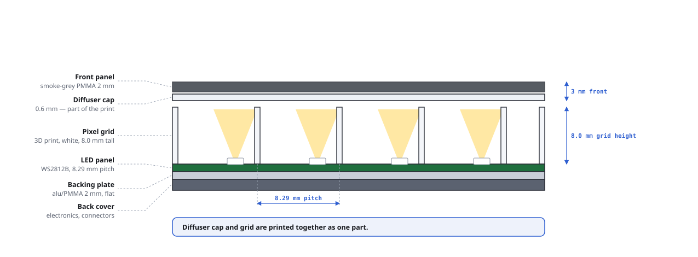
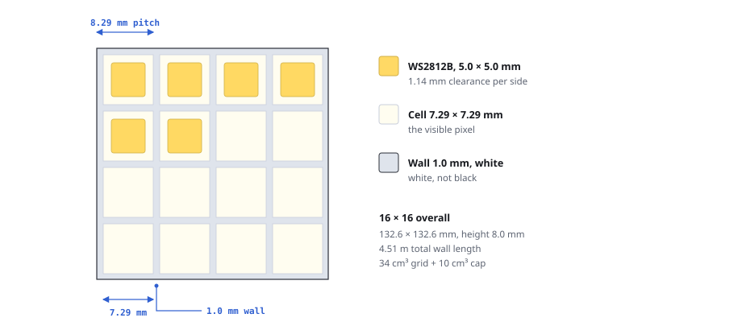
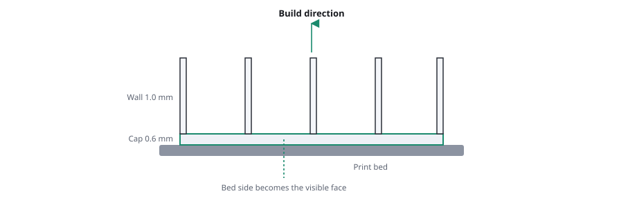

# Pixel Grid for Square Pixels: Build Guide

WS2812B at **8.29 mm pitch** · grid and diffuser as a single 3D-printed part

## 1 · Layer Stack

From front to back:

| Layer | Material | Thickness |
|---|---|---|
| Front panel | smoke-grey PMMA | 2 mm |
| Diffuser cap | part of the print | 0.6 mm |
| Pixel grid | 3D print, white | 8.0 mm |
| LED panel | WS2812B, 8.29 mm pitch | |
| Backing plate | alu/PMMA, flat | 2 mm |
| Back cover | electronics, connectors | |

Diffuser cap and grid are printed together as one part.

## 2 · Dimensions

| Dimension | Value | Note |
|---|---:|---|
| **Pitch** | 8.286 mm | = 58 mm ÷ 7 gaps, measured center to center across 8 LEDs |
| **Wall thickness** | 1.0 mm | 2 perimeters at 0.5 mm line width |
| **Cell, clear width** | 7.29 × 7.29 mm | the visible pixel |
| **Clearance around the LED** | 1.14 mm per side | package 5.0 mm (5050), gap 3.29 mm |
| **Grid height** | 8.0 mm | 40 layers at 0.2 mm · ±42° viewing angle |
| **Diffuser cap** | 0.6 mm | 3 layers at 0.2 mm |
| **Total part height** | 8.6 mm | grid + cap |

### Outer dimensions and material by panel size

| Panel | Cell field | Span center to center | Material |
|---|---:|---:|---:|
| **8 × 8** | 66.3 × 66.3 mm | 58 × 58 mm | 11.5 cm³ ≈ 14 g |
| **16 × 16** | 132.6 × 132.6 mm | 124 × 124 mm | 44.3 cm³ ≈ 55 g |

Cell field = count × pitch. Size the part's outer contour to the PCB, not to the cell field, otherwise the edge cells stick out past the board.

### Choosing a different grid height

| Height | Layers at 0.2 mm | Viewing angle | Use case |
|---|---:|---:|---|
| **7.0 mm** | 35 | ± 46° | display is often viewed at an angle |
| **8.0 mm** | 40 | ± 42° | default for this guide |
| **9.0 mm** | 45 | ± 39° | viewed head-on |

Viewing angle = `arctan(7.29 / height)`. Rule of thumb: height ≈ pitch.

## 3 · Grid in Detail

- **WS2812B**, 5.0 × 5.0 mm, 1.14 mm clearance per side
- **Cell** 7.29 × 7.29 mm, the visible pixel
- **Wall** 1.0 mm, white (not black)
- **16 × 16 overall:** 132.6 × 132.6 mm, height 8.0 mm, 4.51 m total wall length, 34 cm³ grid + 10 cm³ cap

> [!WARNING]
> **Measuring the pitch correctly:** measure center to center across the whole row and divide by the number of *gaps*, not by the number of LEDs. With 8 LEDs that's 7 gaps: 58 mm ÷ 7 = 8.286 mm. Divide by 8 and you wrongly get 7.25 mm.

## 4 · Print Orientation

Print upside down: diffuser cap on the bed, walls pointing up. The bed side becomes the visible face.

| Slicer setting | Value |
|---|---|
| **Orientation** | cap on the bed, walls pointing up |
| **Supports** | none |
| **Layer height** | 0.2 mm |
| **Bottom layers (= cap)** | 3 |
| **Bottom layer pattern** | aligned rectilinear, 0° / 90° |
| **Perimeters** | 2 at 0.5 mm line width (gives a 1.0 mm wall) |
| **Infill** | 0 % (the walls are pure perimeters) |
| **Filament** | white, PLA or PETG |
| **Build plate** | smooth for white filament, textured for clear |

## 5 · Front Panel

Smoke-grey PMMA, 2 mm. Pick the transmission by the contrast you want:

| Tint | Transmission | LED light passed | Contrast |
|---|---:|---:|---:|
| **light grey** | 60 % | 60 % | ×1.7 |
| **smoke grey** | 40 % | 40 % | ×2.5 |
| **dark grey** | 30 % | 30 % | ×3.3 |

Recommended: 30 to 40 %. Ambient light passes through the panel twice, LED light once, hence the contrast gain of `1/T`.

## 6 · Workflow

1. **Verify the pitch.** Measure from the first to the last LED of a row and divide by the number of gaps. Target: 8.29 mm. If it differs, use your measured value; don't average.
2. **Print a test tile.** 4 × 4 cells at the measured pitch, with cap thicknesses of 2 / 3 / 4 / 5 layers across the cells. Lay it on the powered panel, then settle on fit and cap thickness.
3. **Model the grid.** Cell pitch as measured, 1.0 mm wall, 8.0 mm height, cap at the chosen thickness. Size the outer contour to the PCB, not to 8 × pitch.
4. **Print.** Upside down, no supports, settings from section 4.
5. **Mount the panel.** Glue a flexible panel full-surface onto the 2 mm backing plate, keeping it flat. Screw rigid panels on directly.
6. **Dry-fit.** Stack backing plate, grid and front panel without screws, power up the panel and check that the cells line up.
7. **Final assembly.** Place grid and front panel in the frame, screw together from the back. No screws remain visible at the front.

> [!IMPORTANT]
> **Finish steps 1 and 2 before step 3.** Pitch and cap thickness can't be changed once the part is printed.

## 7 · Bill of Materials

| Part | Material / size | Qty 8×8 | Qty 16×16 |
|---|---|---|---|
| **Grid + diffuser** | PLA or PETG, white | ≈ 14 g | ≈ 55 g |
| **Front panel** | smoke-grey PMMA 2 mm, 30 to 40 % T | PCB size | PCB size |
| **Backing plate** | aluminum or PMMA 2 mm | PCB size | PCB size |
| **LED panel** | WS2812B, 8.29 mm pitch | 1 | 1 |
| **Frame** | 3D print, all around | 1 | 1 |
| **Screws** | M3 × 10, from the back | 4 to 8 | 8 to 12 |

## Sources

- [Marian Kleineberg: LED Matrix Materials Guide](https://marian42.de/article/ledmatrix-tutorial/) 
  Material comparison for grid and diffuser; evidence that the diffuser has to be thin and that a 3D-printed grid beats cardboard and wood versions.
- [fractalnoise: 32×32 LED Matrix Frame with Diffuser Grid (Printables)](https://www.printables.com/model/757665-32x32-led-matrix-frame-with-diffuser-grid) 
  Source of the slicer settings: aligned rectilinear 0°/90°, white filament on a smooth plate or clear on a textured one.
- [16×16 LED Matrix Frame with Diffuser Grid (MakerWorld)](https://makerworld.com/en/models/122272-16x16-led-matrix-frame-with-diffuser-grid) 
  Ready-made 16×16 model, as a reference or starting point; check the pitch.
- [8×8 WS2812B Matrix Diffuser (MakerWorld)](https://makerworld.com/en/models/551021-8x8-ws2812b-matrix-diffuser) 
  Small version, useful as a test print for cap thickness and fit.
- [htcam: Customisable LED matrix diffuser grid (Thingiverse)](https://www.thingiverse.com/thing:4973163) 
  Parametric model: pitch, wall thickness and height are directly adjustable, so pitch can be set straight to 8.286 mm.
- [Glow Flow: LED Diffusion Test with a 3D-Printed Sheet](https://newscrewdriver.com/2019/07/18/glow-flow-led-diffusion-test-3d-printed-sheet/) 
  Measurement series on LED-to-diffuser distance: below 1 mm pixels stay separate, from 10 mm on they blend together.
- [Hackaday: Clear PLA Diffuses LEDs](https://hackaday.com/2023/02/20/clear-pla-diffuses-leds/) 
  Scattering behavior of clear versus white filament.
- [Divoom Pixoo: 16×16 Pixel Art Display](https://divoom.com/products/divoom-pixoo) 
  Reference device for the look we're after.

---

*Build guide for project `retropixel`.*
