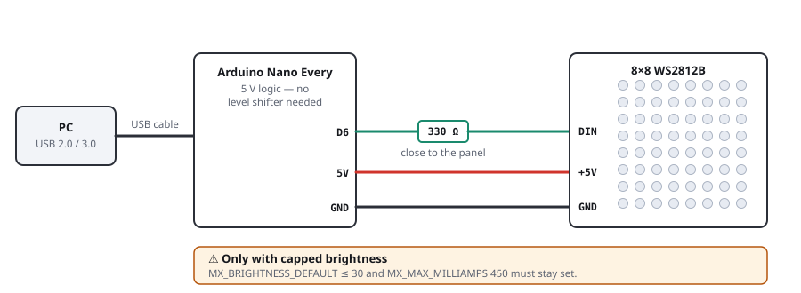
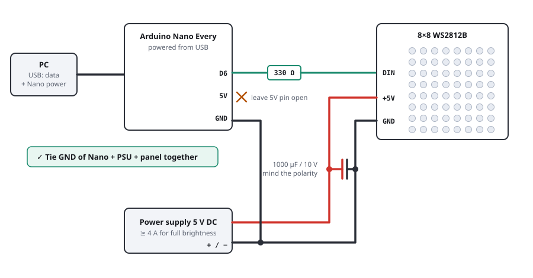

# Wiring Diagram: 8×8 WS2812B on the Arduino Nano Every

Project `retropixel` · data line D6 → DIN · as of August 2026

> [!WARNING]
> 64 WS2812Bs draw around **3.8 A** at full white. A USB 2.0 port delivers 500 mA, that's a factor of 8 too little. For *full* brightness you need a dedicated 5 V power supply. For *dimmed* operation USB is enough: up to brightness ≈ 30/255 the current stays within the 500 mA even in the worst case (everything white). That's exactly what the firmware is set to out of the box.

## The Power Budget

### What the panel draws

| State | per LED | 64 LEDs |
|---|---:|---:|
| All off (quiescent current of the controller ICs) | ≈ 1 mA | 64 mA |
| One color at full (e.g. pure red) | ≈ 20 mA | 1.28 A |
| Full white, datasheet, 3 × 20 mA | 60 mA | 3.84 A |
| Full white, measured, "type B" (PJRC) | 52.5 mA | 3.36 A |
| Full white, measured, "type A" (PJRC) | 33.5 mA | 2.14 A |

The spread is real: PJRC measured two batches, both sold as "WS2812B", and got 33.5 mA and 52.5 mA per LED respectively. Calculate with the datasheet value and you'll be on the safe side.

### What USB delivers

| Source | Budget | for LEDs | Full white possible | max. brightness |
|---|---:|---:|---:|---:|
| USB 2.0 port | 500 mA | 470 mA | 7 of 64 | 31/255 |
| USB 3.0 port | 900 mA | 870 mA | 14 of 64 | 58/255 |
| 5 V power supply ≥ 4 A | 4000 mA | 4000 mA | all 64 | 255/255 |

"for LEDs" = budget minus ≈ 30 mA that the Nano Every itself needs. "max. brightness" is the value at which even a completely white frame still stays within budget.

## Option 1: USB only

For the desk, for development, for dimmed displays. Two fewer wires.

Wire colors: 🟢 green = data · 🔴 red = +5 V · ⚫ black = GND

| Nano Every | | Panel |
|---|---|---|
| D6 | → 330 Ω (close to the panel) → | DIN |
| 5V | → | +5V |
| GND | → | GND |

> [!CAUTION]
> **Only with capped brightness:** `MX_BRIGHTNESS_DEFAULT ≤ 30` and `MX_MAX_MILLIAMPS 450` must stay set.

## Option 2: external 5 V power supply (recommended)

Full brightness, stable colors, no risk to the computer's USB port. The Nano stays on USB, it needs it for the data anyway.

| From | To | Note |
|---|---|---|
| Nano D6 | 330 Ω → panel DIN | |
| Nano 5V | (nothing) | **leave the 5V pin open** |
| Nano GND | common ground | |
| PSU + (5 V, ≥ 4 A) | panel +5V | |
| PSU − | panel GND, common ground | |
| 1000 µF / 10 V electrolytic cap | between +5V and GND at the panel | mind the polarity |

> [!TIP]
> **Why the grounds have to be joined:** the data signal is a voltage *relative to GND*. Without a common reference the panel doesn't "see" a clean high/low. The typical symptom is wildly flickering LEDs or none at all, even though everything looks correctly wired. This is by far the most common mistake with this setup. Tie GND of Nano, PSU and panel together.

## Bill of Materials

| Part | Value | Purpose |
|---|---|---|
| Resistor | 330 Ω (220 to 470 Ω) | damps reflections on the data line, protects the first LED's input. Place as close to the panel as possible. |
| Electrolytic capacitor | 1000 µF, ≥ 10 V | buffers current spikes on color changes, directly at the panel terminals |
| Power supply | 5 V DC, ≥ 4 A | option 2 only. 4 A covers full white with headroom. |
| Stranded wire | ≥ 0.5 mm² for 5 V/GND | at 3.8 A a thin wire drops a noticeable amount of voltage |

## Six Things That Go Wrong

- **Panel 5V wired to the Nano's 5V pin even though a power supply is connected.** Then the power supply feeds back through the Nano into the computer's USB port. The Nano Every does have a diode in this path, but don't rely on it: with option 2, simply leave the 5V pin unconnected.
- **Forgetting ground.** See above. Always connect all three GNDs.
- **Turning up the brightness on USB power.** The port goes into current limiting, the voltage collapses, the Nano resets mid-frame. Looks like a software bug, but it's electrical.
- **Voltage drop at the 5V pin.** On USB power the Nano's 5V pin often sits at only ≈ 4.7 V. WS2812Bs run on that, but white turns slightly yellowish and brightness drops.
- **Feeding the wrong end.** Some panels have DIN/DOUT labeled; the data line goes to `DIN`. On `DOUT` simply nothing happens.
- **Plugging in the power supply only after USB.** Better the other way round or at the same time; the electrolytic cap damps the inrush.

## No Level Shifter Needed

The Nano Every runs on **5 V logic**. For a clean high, WS2812Bs want to see at least 0.7 × VDD ≈ 3.5 V; with 5 V from the pin that fits with room to spare. That's a real advantage over the 3.3 V boards of the Nano 33 family, where you need a level shifter or the trick of using the first LED as a sacrificial pixel.

## Matching Firmware Settings

In `FW/mx8_config.h`:

| Setup | `MX_BRIGHTNESS_DEFAULT` | `MX_MAX_MILLIAMPS` |
|---|---:|---:|
| USB 2.0, no power supply | 30 | 450 |
| USB 3.0, no power supply | 58 | 850 |
| Power supply 5 V / 4 A | 255 | 3800 |
| Power supply, but the panel should stay dim | 128 | 2000 |

`MX_MAX_MILLIAMPS` is the harder of the two limits: before every `show()`, FastLED calculates the frame's current draw and automatically turns the brightness down if it would exceed the limit. That's why the out-of-the-box combination "brightness 30 + limit 450 mA" is safe even when a frame is completely white.

---

*Per-LED measurements from PJRC (two actually measured WS2812B batches), Nano Every specs from Arduino datasheet ABX00028 and the Arduino forum. Generated for project `retropixel`.*
